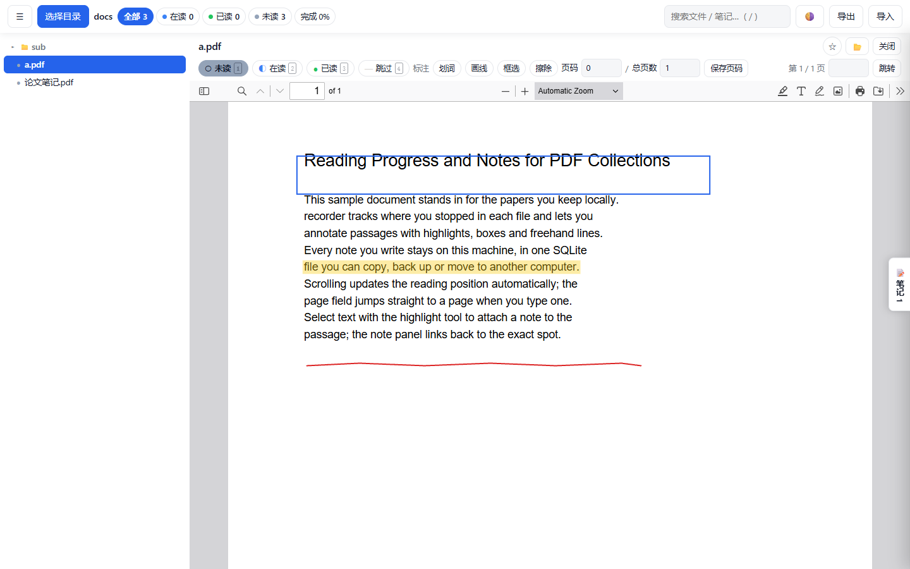
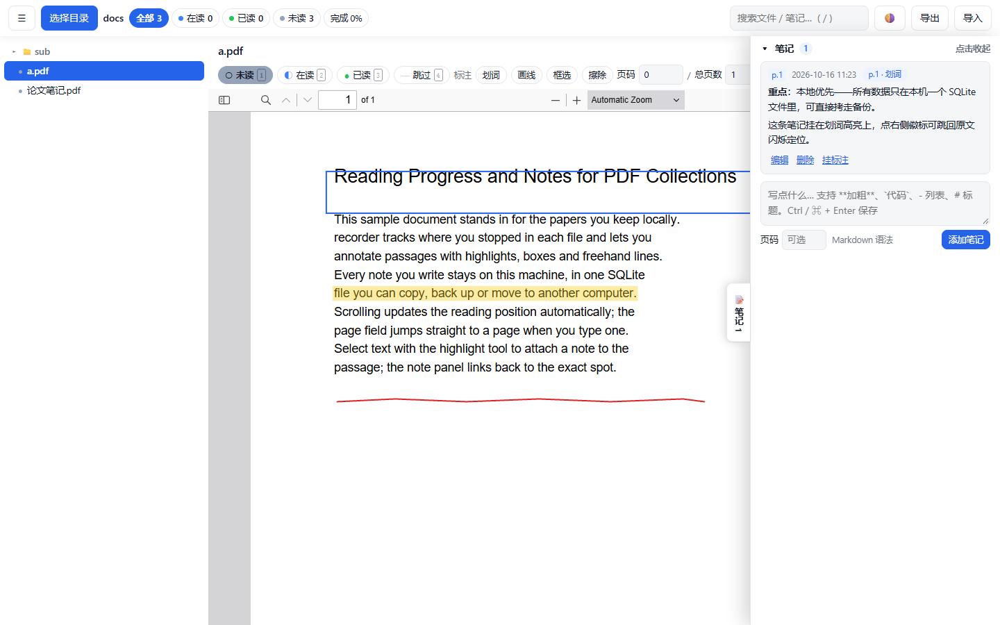
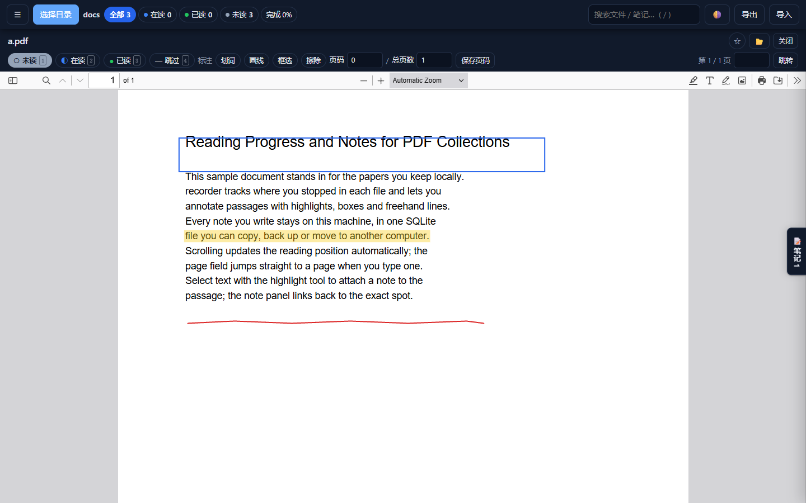

# recorder

本地优先的 Windows PDF 阅读器：**阅读进度 + 笔记 + 标注**，数据全部存在你自己的电脑上。

[](https://github.com/skyarea/recorder/actions/workflows/ci.yml)
[](https://github.com/skyarea/recorder/actions/workflows/secret-scan.yml)

一个单文件 exe，无需安装、无需账号、不联网。到 [Releases](https://github.com/skyarea/recorder/releases/latest) 下载 `recorder.exe`，双击即用（Windows 10/11；若提示缺 WebView2，按弹窗链接装一次即可）。

## 界面

左侧是 PDF 目录树与阅读状态，中间读文档，标注直接画在页面上，笔记从右侧滑出。



| 笔记抽屉 | 深色主题 |
| --- | --- |
|  |  |

## 功能

- **目录树扫描** —— 指定一个根目录，递归列出所有 PDF；路径按相对路径记录，换机器也能对上
- **阅读状态与进度** —— `未读 / 在读 / 已读 / 跳过` 四态，滚动自动记录进度，星标收藏
- **三种标注** —— 划词高亮、自由画线、矩形框选，归一化坐标防缩放漂移，可擦除
- **手写笔记** —— 笔记完全手写（不自动生成），支持 Markdown
- **笔记 ↔ 标注互链** —— 多对多关联；标注后就地弹框写笔记，面板里可补挂 / 取消挂；点徽标跳回 PDF 对应位置并闪烁定位
- **统计与搜索** —— 状态统计，全文搜索笔记
- **导出 / 导入 JSON** —— 备份与迁移，兼容旧版 HTML 应用的格式
- **深色 / 浅色主题** —— 跟随系统，可手动切换并记住
- **可收起的布局** —— 目录树和笔记抽屉都能收起来，把屏幕让给文档

阅读器本身是 pdf.js 官方 viewer（vendored），查找、打印、缩略图、大纲、缩放都在。

### 快捷键

| 键 | 作用 |
| --- | --- |
| `J` / `↓` `K` / `↑` | 在列表里跳到下一个 / 上一个文件 |
| `1` `2` `3` `4` | 设为 `待读` / `在读` / `已读` / `跳过` |
| `S` | 切换星标 |
| `/` | 光标进搜索框 |
| `Enter` | 页码框里回车 = 跳页 |
| `Ctrl+Enter` | 保存正在写的笔记 |
| `Esc` | 取消编辑中的笔记 |

## 数据与备份

数据全在本机，只有一个 SQLite 文件：

```
%APPDATA%\recorder\recorder.db
```

不放程序目录（避免 UAC 虚拟化与卸载残留），你可以直接找到它、直接拷走它。
迁移到另一台机器用「导出 JSON」—— 备份格式与旧版网页应用通用，所以
**从旧版导出的 JSON 可以直接导入新版**。反过来不成立：旧版 localStorage 的数据
不会自动搬过来，要先用旧版导出。

## 从源码构建

需要 Go 1.26.4+（见 `go.mod`）。

```bash
go run .                # 开发运行：开窗并加载本地服务的前端
make                    # 打包 dist/recorder.exe（带图标与版本信息）
make test               # 全量回归（go test ./... + node --test）
```

`make` 需要 `go install github.com/tc-hib/go-winres@latest`。没有 `make` 就照 `Makefile`
里的两条命令手跑。

## License

尚未选定。代码目前**没有** `LICENSE` 文件 —— 在你补上之前，默认保留所有权利。
