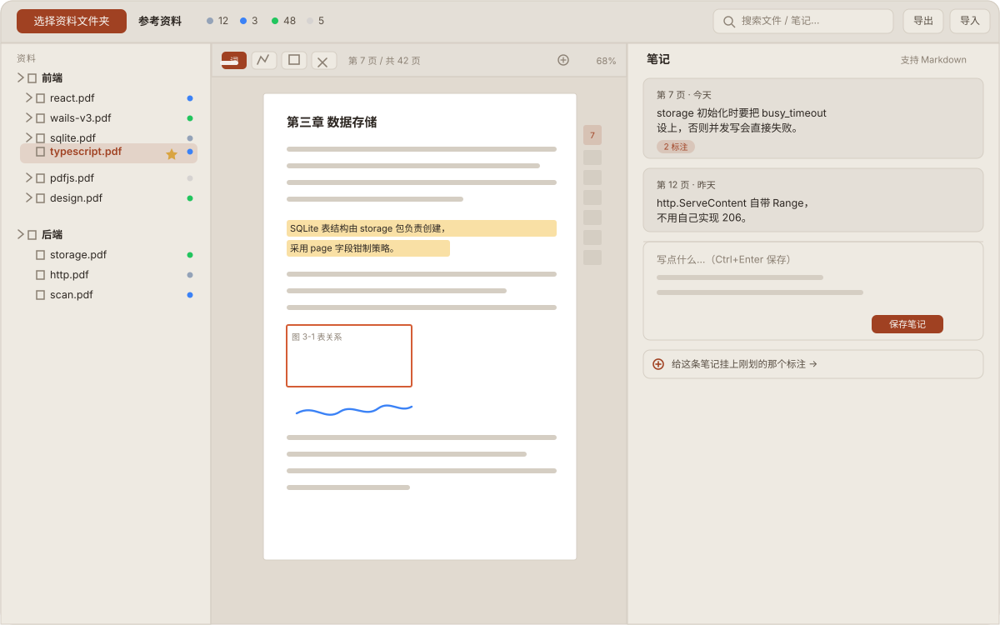

# recorder

本地优先的 Windows PDF 阅读器：**阅读进度 + 笔记 + 标注**，数据全部存在你自己的电脑上。

[](https://github.com/skyarea/recorder/actions/workflows/ci.yml)
[](https://github.com/skyarea/recorder/actions/workflows/secret-scan.yml)

*这将是一个*单文件 exe，无需安装、无需账号、不联网。**现在还没有能下载的程序。**

## 现在的状态

**很早的阶段。** `go run .` 会开出一个窗口，里面只有一页占位文字 —— 没有任何功能。

已经写好的部分是三个 Go 库（有单元测试），以及把它们包起来的窗口骨架：

| 已就绪 | 说明 | 用的地方 |
| --- | --- | --- |
| 数据层 | SQLite（纯 Go）—— 文件、进度、星标、笔记、标注、笔记↔标注多对多 | 有测试 |
| 目录扫描 | 递归收集 PDF，路径为「根目录相对路径」，页数嗅探 | 有测试 |
| 备份 | JSON 导出 / 导入，格式与旧版网页应用兼容 | 有测试 |
| 窗口骨架 | Wails v3 窗口 + 嵌入前端资源 | 靠 `go build` 验证 |

**这四个包目前还没有被主程序调用过** —— `main.go` 只负责开窗，三个库只被测试引用。
所以「写完了」不等于「能用」，它们要等 #6 的本地服务接进来才会真正跑起来。

还没做的（按 [issue](https://github.com/skyarea/recorder/issues) 计，而非按内部计划计）：

| # | 事项 |
| --- | --- |
| #6 | 本地 HTTP 服务与 `/api/*` 接口 |
| #7 | PDF 真的能读（`/files/*` + pdf.js 阅读器） |
| #8 | 应用界面（目录树、状态、搜索、主题） |
| #9 | 阅读进度自动跟随 |
| #10 ~ #13 | 三种标注工具（划词 / 画线 / 框选）与回访 |
| #14 | 笔记 ↔ 标注双向互链 |
| #15 | 打包成单文件 exe |

想跟踪进度看 [Issues](https://github.com/skyarea/recorder/issues)；
想了解设计意图看 [设计文档](docs/superpowers/specs/2026-10-13-pdf-reader-desktop-design.md)；
想了解实施顺序看 [实现计划](docs/superpowers/plans/2026-10-13-pdf-reader-desktop.md)。

## 界面示意

下面是这个应用打算长成的样子 —— 一张矢量示意，不是运行截图（还没有可截的程序）。



图本身在深浅两种模式下都是自洽的（这两套配色都各自满足正文对比度 4.5:1），
所以不会出现「深色页面上贴一张浅底图看不清」的情况。
跟随的是系统主题，不是 GitHub 右上角的主题开关。

## 从源码构建

需要 Go 1.26.4+（见 `go.mod`；CI 用 `go-version-file` 跟随它，低版本会自动拉工具链）。

```bash
go build ./...          # 编译
go test ./... -count=1  # 测试
go vet ./...            # 静态检查

go run .                # 运行（开发）—— 目前只显示占位页
```

Node 只在两个地方需要：CI 里跑落地页配色自检（`node docs/landing/check-contrast.mjs`），
以及将来 vendor pdf.js。构建本项目本身不需要。

数据目录（设计目标）见下面的「数据与备份」一节。

### 提交前

启用本地 git 钩子（拦截密钥、敏感文件与大文件）：

```bash
bash scripts/install-hooks.sh
```

## 数据与备份

数据全在本机，只有一个 SQLite 文件：

```
%APPDATA%\recorder\recorder.db
```

不放程序目录（避免 UAC 虚拟化与卸载残留），你可以直接找到它、直接拷走它。
迁移到另一台机器用「导出 JSON」—— 备份格式与旧版网页应用通用，所以
**从旧版导出的 JSON 可以直接导入新版**。反过来不成立：旧版 localStorage 的数据
不会自动搬过来，要先用旧版导出。

**注意：目前还没有代码会打开这个库**，所以现在跑起来不会生成这个文件。

## 功能（目标形态）

以下是这个应用做出来之后应该有的样子。除上面表格里那几个库之外，
界面层一项都还没有开始。

- **目录树扫描** —— 指定一个根目录，递归列出所有 PDF；路径用相对路径记录，换机器也能对上
- **阅读状态与进度** —— `待读 / 在读 / 已读 / 跳过` 四态，滚动自动记录进度，星标收藏
- **三种标注** —— 划词高亮、自由画线、矩形框选
- **手写笔记** —— 笔记完全手写（不自动生成），支持 Markdown
- **笔记 ↔ 标注互链** —— 多对多关联；从笔记一键跳回 PDF 对应位置，从标注也能反向找到笔记
- **统计与搜索** —— 状态统计、全文搜索笔记
- **导出 / 导入 JSON** —— 备份与迁移，兼容旧版 HTML 应用的格式
- **深色 / 浅色主题** —— 快捷键 `J` `K` `1-4` `S` `/`

### 快捷键（目标形态）

沿用参考实现的键位，尚未实现：

| 键 | 作用 |
| --- | --- |
| `J` / `↓` `K` / `↑` | 在列表里跳到下一个 / 上一个文件 |
| `1` `2` `3` `4` | 设为 `待读` / `在读` / `已读` / `跳过` |
| `S` | 切换星标 |
| `/` | 光标进搜索框 |
| `Enter` | 页码框里回车 = 跳页 |
| `Ctrl+Enter` | 保存正在写的笔记 |
| `Esc` | 取消编辑中的笔记 |

## 技术选型

| 层 | 选型 | 理由 |
| --- | --- | --- |
| 应用外壳 | Go + [Wails v3](https://v3alpha.wails.io/) | 单进程、单文件 exe，WebView2 渲染 |
| 前端 | 无框架原生 JS/HTML | 由旧版参考实现移植，零构建步骤 |
| PDF 渲染 | pdf.js 官方 viewer（vendored） | 保留查找、打印、缩略图、大纲、缩放 |
| 数据 | SQLite via `modernc.org/sqlite` | 纯 Go，**无 CGO**，交叉编译无痛 |
| 前后端通信 | 进程内 HTTP + `fetch('/api/*')` | 无绑定生成器、无打包器、无代码生成 |

架构借鉴 [magpie](https://github.com/yetone/magpie)（MIT）的「embed 前端资产 + 自有 HTTP handler」模式。

## 工程约定

- **无 CGO**：SQLite 必须用 `modernc.org/sqlite`，测试在 `CGO_ENABLED=0` 下通过
- **无绑定生成器、无打包器**：纯 `go build` + `//go:embed`
- **数据不迁移**：不兼容旧版 localStorage 数据（导出 / 导入 JSON 仅作备份功能）
- **单根目录**：打算记住上次扫描目录并在启动时自动重扫，文件身份为「根目录相对路径、`/` 分隔」—— 见 #6

设计文档在 [`docs/superpowers/specs/`](docs/superpowers/specs/)，
实现计划在 [`docs/superpowers/plans/`](docs/superpowers/plans/)。

## CI

| Workflow | 触发 | 内容 |
| --- | --- | --- |
| [CI](.github/workflows/ci.yml) | push / PR | `gofmt`、`go vet`、`go build`、`go test`（`CGO_ENABLED=0`）、落地页配色对比度 |
| [Secret scan](.github/workflows/secret-scan.yml) | push / PR | gitleaks 全历史密钥扫描 |
| [Release](.github/workflows/release.yml) | tag `v*` / 手动 | 构建并发布 `recorder.exe`（尚无 tag，从未运行） |
| [Deploy Pages](.github/workflows/pages.yml) | `docs/pages/**` 变更 | 发布下载引导页（工作流本身可用，但仓库尚未启用 Pages） |

## License

尚未选定。代码目前**没有** `LICENSE` 文件 —— 在你补上之前，默认保留所有权利。
